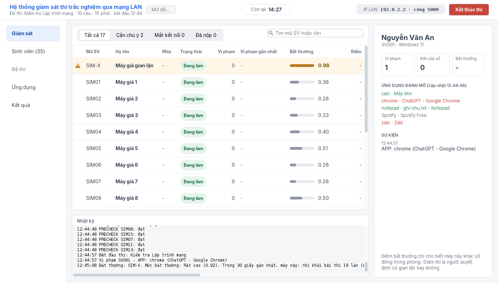
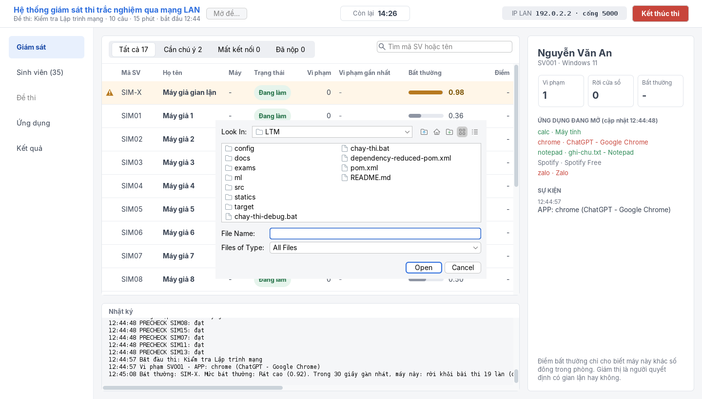
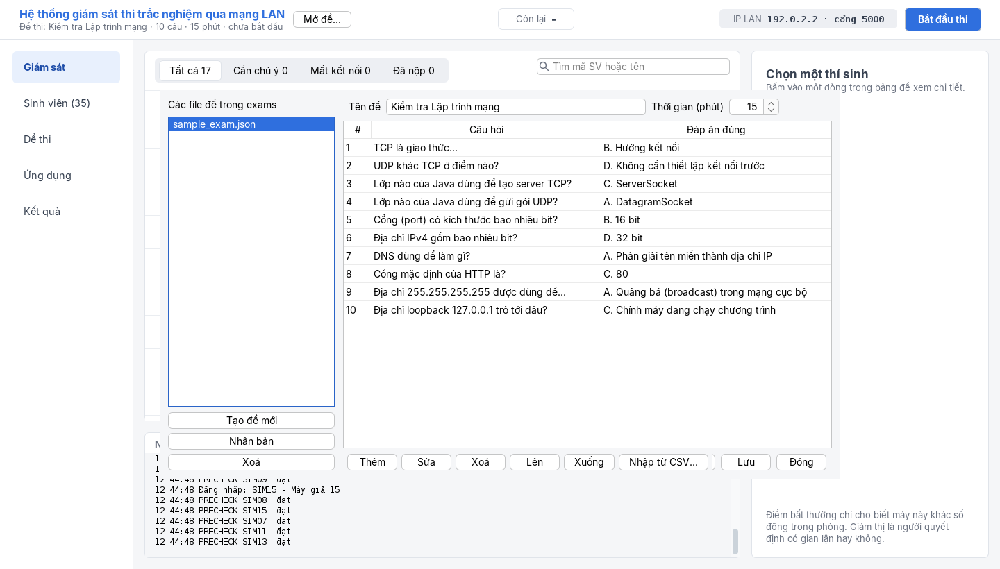
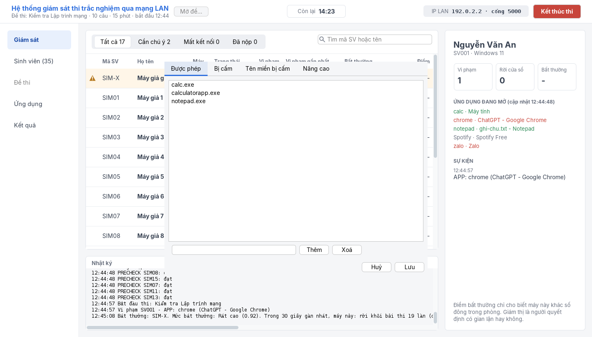
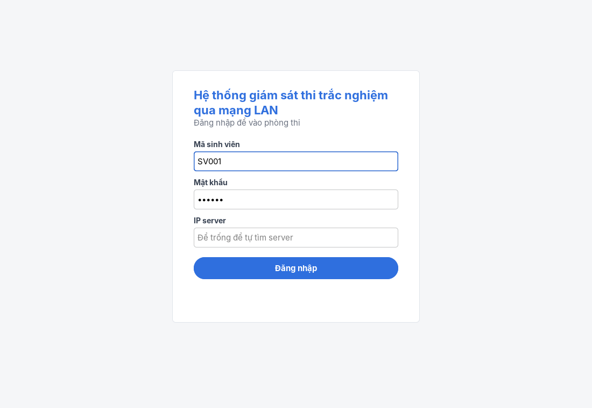
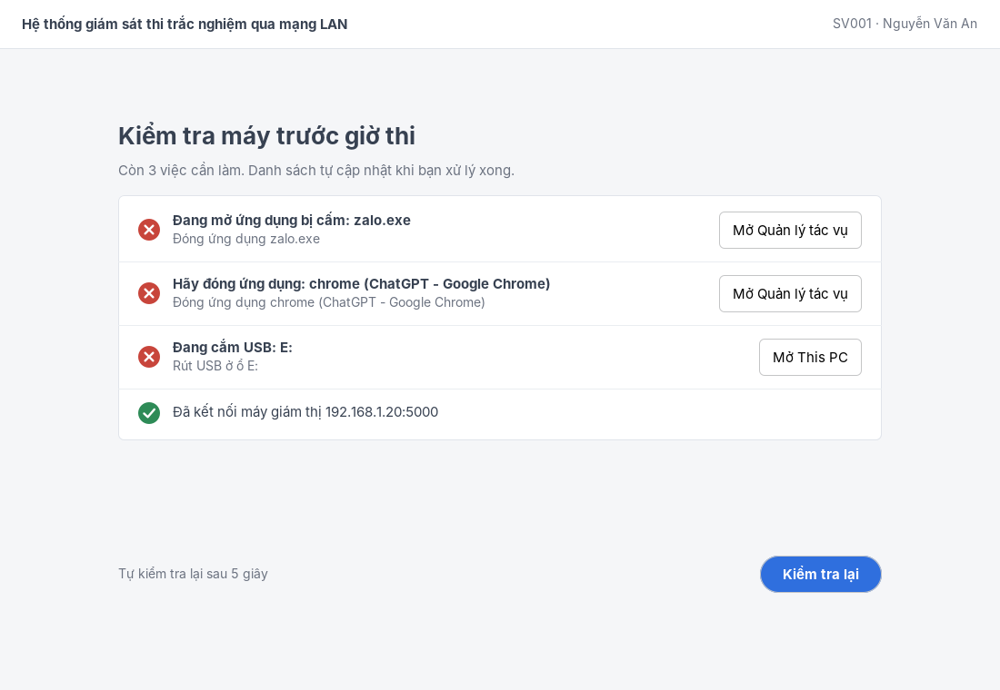
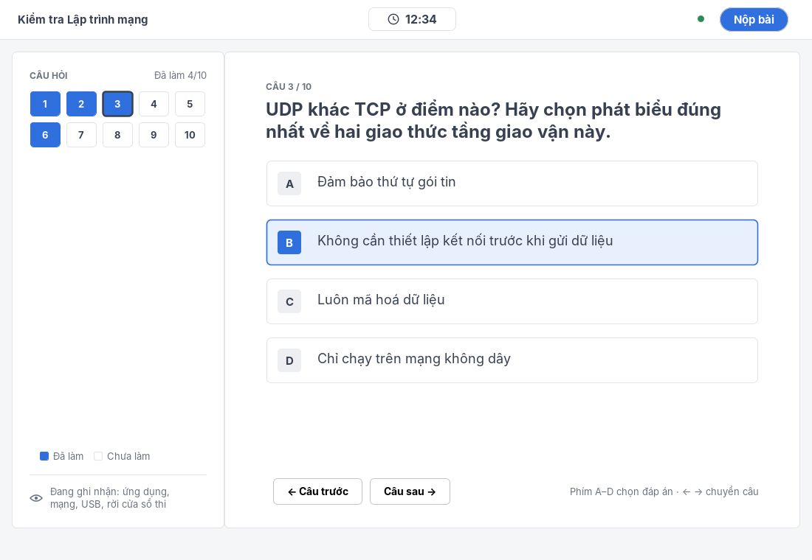

# Hệ thống giám sát thi trắc nghiệm qua mạng LAN

Bài tập lớn môn Lập trình mạng, Nhóm 18, Học viện Công nghệ Bưu chính Viễn thông.

Giám thị chạy **server** trên một máy trong mạng LAN; thí sinh mở **client** trên máy Windows của mình, tự tìm server, đăng nhập và làm bài trắc nghiệm. Trong giờ thi, client giám sát theo luật (ứng dụng bị cấm, cửa sổ lạ, tên miền bị cấm, USB) và gửi về server các số đếm hành vi; một **dịch vụ Python** dùng Isolation Forest so từng máy với cả phòng để cảnh báo máy có hành vi khác thường. Vi phạm luật thì bị đình chỉ tự động; cảnh báo của mô hình chỉ để giám thị quyết định.



**Mục lục:** [1. Yêu cầu](#1-yêu-cầu) · [2. Chạy thử nhanh trên một máy](#2-chạy-thử-nhanh-trên-một-máy) · [3. Triển khai nhiều máy trong LAN](#3-triển-khai-nhiều-máy-trong-lan) · [4. Kiểm thử](#4-kiểm-thử) · [5. Cấu hình và dữ liệu](#5-cấu-hình-và-dữ-liệu) · [6. Kiến trúc và giao thức](#6-kiến-trúc-và-giao-thức) · [7. Sử dụng](#7-sử-dụng) · [8. Xử lý sự cố](#8-xử-lý-sự-cố) · [9. Giới hạn đã biết](#9-giới-hạn-đã-biết) · [10. Cấu trúc mã nguồn và phân công](#10-cấu-trúc-mã-nguồn-và-phân-công)

## 1. Yêu cầu

| Thành phần | Phiên bản | Dùng cho |
|---|---|---|
| JDK | 17 trở lên | Build và chạy server, client |
| Maven | 3.8 trở lên | Build, chạy test Java (tự tải thư viện, cần Internet lần đầu) |
| Python | 3.10 trở lên | Dịch vụ ML và máy giả lập |
| Hệ điều hành | Server: Linux, Windows hoặc macOS (có giao diện). Client: **Windows 10/11** | Phần giám sát ứng dụng, mạng, USB chỉ chạy trên Windows; client trên Linux/macOS vẫn đăng nhập và làm bài được để thử |

Thư viện (tự cài, không cần tải tay):

| Ngôn ngữ | Thư viện | Phiên bản | Vai trò |
|---|---|---|---|
| Java | Gson | 2.11.0 | Đọc/ghi JSON |
| Java | FlatLaf | 3.7.2 | Giao diện Swing |
| Java | JUnit Jupiter | 5.10.2 | Kiểm thử |
| Python | fastapi, uvicorn | bản mới nhất | API `POST /score` |
| Python | scikit-learn, numpy | bản mới nhất | Isolation Forest |
| Python | pytest, httpx | bản mới nhất | Kiểm thử dịch vụ ML |

Mặc định dùng các cổng: **TCP 5000** (thi), **UDP 9999** (tìm server), **HTTP 8000** chỉ trên localhost (server gọi dịch vụ ML).

## 2. Chạy thử nhanh trên một máy

Khoảng 5 phút, chạy được trên một máy Linux, Windows hoặc macOS. Máy giả lập sẽ đóng vai cả phòng thi để có đủ dữ liệu cho ML.

**Bước 1. Lấy mã nguồn và build** (từ đây trở đi luôn đứng ở thư mục gốc của repo):

```bash
git clone https://github.com/tanh8805/exam-monitor-lan.git
cd exam-monitor-lan
mvn -q package -DskipTests        # tạo target/exam.jar; bỏ -DskipTests nếu muốn chạy luôn 160 test
```

**Bước 2. Cài môi trường Python** (một lần):

```bash
python3 -m venv ml/.venv
ml/.venv/bin/pip install -r ml/requirements.txt          # Windows: ml\.venv\Scripts\pip install -r ml\requirements.txt
```

**Bước 3. Mở 4 cửa sổ terminal ở thư mục gốc repo và chạy lần lượt:**

| Terminal | Lệnh (Linux/macOS) | Lệnh (Windows) |
|---|---|---|
| 1. Dịch vụ ML | `cd ml && .venv/bin/python -m uvicorn ml_service:app --host 127.0.0.1 --port 8000` | `cd ml && .venv\Scripts\python -m uvicorn ml_service:app --host 127.0.0.1 --port 8000` |
| 2. Server | `java -cp target/exam.jar exam.server.ExamServer` | như bên trái |
| 3. Máy giả lập | `cd ml && .venv/bin/python simulate_clients.py --count 18 --cheater` | `cd ml && .venv\Scripts\python simulate_clients.py --count 18 --cheater` |
| 4. Client | `java -Dexam.allowTerminal=true -cp target/exam.jar exam.client.StudentApp` | như bên trái |

Chạy terminal 3 và 4 **sau khi** đã làm bước 4 bên dưới (server chưa có danh sách sinh viên thì từ chối mọi đăng nhập). Cờ `-Dexam.allowTerminal=true` chỉ dùng khi chạy client từ terminal để thử; máy thi thật mở client bằng `chay-thi.bat`.

**Bước 4. Trên cửa sổ giám thị** (mở ra ở terminal 2):

1. Bấm **Sinh viên** ở thanh bên trái → **Nhập file CSV...** → chọn `config/lop-mau.csv` (35 tài khoản, mật khẩu đều là `123456`).
2. Bấm **Mở đề...** ở thanh trên → chọn `exams/sample_exam.json` (10 câu, 15 phút).
3. Chạy terminal 3 (18 máy giả bình thường SIM01–SIM18 và 1 máy giả gian lận SIM-X) và terminal 4 (client thật). Trên client, để trống ô **IP server** để tự tìm server, đăng nhập **SV001 / 123456** và chờ bước kiểm tra máy (PRECHECK) đạt.
4. Khi các máy hiện **Sẵn sàng**, bấm **Bắt đầu thi**.

**Kết quả mong đợi:** client nhận đề và đồng hồ đếm ngược; sau khoảng 1 phút, dòng **SIM-X** chuyển màu cam với điểm Bất thường gần 1,0 và lý do bằng tiếng Việt, các máy giả bình thường không bị gắn cờ. Nộp bài trên client để thấy điểm. Bấm **Kết thúc thi**, rồi **Kết quả** ở thanh bên để mở thư mục `ket-qua/<thời gian>_<tên đề>/` có `results.csv`, `events.csv`, `server.log`.

## 3. Triển khai nhiều máy trong LAN

**Máy giám thị (server):** làm bước 1–3 ở mục 2 (không cần terminal 3, 4), rồi mở cổng tường lửa:

```bash
# Fedora / RHEL
sudo firewall-cmd --add-port=5000/tcp --add-port=9999/udp
# Ubuntu
sudo ufw allow 5000/tcp && sudo ufw allow 9999/udp
```

Trên Windows, chọn **Allow access** cho Java (cả mạng Private và Public) khi được hỏi. Thanh trên cùng của cửa sổ giám thị hiện **IP LAN** của máy server.

**Máy thí sinh (Windows):** chỉ cần cài Java 17+ (JRE là đủ) và chép **2 file** vào cùng một thư mục: `target/exam.jar` và `chay-thi.bat`. Nhấp đúp `chay-thi.bat` để mở bài thi (client chạy không kèm cửa sổ dòng lệnh, vì mở terminal trong giờ thi là vi phạm).

**Mạng:** tất cả máy phải cùng một mạng LAN (cùng Wi-Fi hoặc hotspot). Khi làm từ xa có thể dùng **ZeroTier** để tạo LAN ảo (Tailscale không hỗ trợ broadcast). Nếu client không tự tìm thấy server, gõ IP LAN của server vào ô **IP server** trên màn hình đăng nhập.

## 4. Kiểm thử

```bash
mvn -q test                                        # 160 test JUnit: giao thức, phòng thi, chấm điểm, luật giám sát, đình chỉ, kết nối lại, watchdog...
cd ml && .venv/bin/python -m pytest -q             # 10 test pytest cho dịch vụ ML (Windows: .venv\Scripts\python -m pytest -q)
```

Phần quét tiến trình, mạng và ổ đĩa chỉ chạy trên Windows nên được thử tay trên máy thật. Các kịch bản chính và kết quả mong đợi:

| Kịch bản trên máy Windows | Kết quả mong đợi |
|---|---|
| Mở Zalo hoặc Chrome rồi đăng nhập | PRECHECK không đạt, liệt kê đúng ứng dụng; đóng đi rồi bấm Kiểm tra lại thì đạt |
| Cắm USB trong giờ thi | Vi phạm `USB`, đình chỉ, 0 điểm |
| Mở Zalo, Chrome, terminal trong giờ thi | Vi phạm `APP`, đình chỉ |
| Truy cập `chatgpt.com` trong giờ thi | Vi phạm `NET` |
| Chuyển qua lại Notepad/Calculator liên tục | Không vi phạm luật, sau vài chu kỳ bị ML gắn cờ Bất thường kèm lý do |
| Tắt Wi-Fi rồi bật lại | Client tự vào lại, thời gian còn lại đúng, giữ đáp án |
| Máy sạch làm bài 5 phút | Không có vi phạm nào do tiến trình nền của Windows |

Khi máy bị báo vi phạm oan: chạy `java -cp exam.jar exam.client.Diagnose` trên máy đó, mở file `chan-doan-<tên máy>.txt` để xem ứng dụng nào gây ra, rồi thêm tên vào `allowedWindowApps` hoặc `ignoreProcesses` (mục 5).

## 5. Cấu hình và dữ liệu

Server phải chạy từ thư mục gốc repo vì đọc các đường dẫn tương đối dưới đây.

| File | Nội dung |
|---|---|
| `config/rules.json` | Luật giám sát, gửi xuống client lúc đăng nhập (sửa được trên giao diện, mục **Ứng dụng**) |
| `config/lop-mau.csv` | Danh sách sinh viên mẫu: `SIM01`–`SIM30`, `SIM-X` (cho máy giả) và `SV001`–`SV004`, mật khẩu `123456` |
| `exams/*.json` | Đề thi (soạn được trên giao diện, mục **Đề thi**) |
| `ket-qua/<thời gian>_<tên đề>/` | Kết quả mỗi kỳ thi, tạo khi bấm Bắt đầu thi |

**`config/rules.json`:**

| Khoá | Ý nghĩa |
|---|---|
| `blacklistApps` | Ứng dụng bị cấm, bắt cả khi chạy nền (trình duyệt, Zalo, công cụ AI, `git`, `curl`, `ssh`…) |
| `whitelistApps` | Ứng dụng được phép mở trong giờ thi (Calculator, Notepad) |
| `allowedWindowApps` | Cửa sổ hệ thống được phép (Explorer, Java…) |
| `ignoreProcesses` | Tiến trình nền bỏ qua hoàn toàn (driver âm thanh, OneDrive…) |
| `blockedDomains` | Tên miền bị cấm (chatgpt.com, github.com…) |
| `featureIntervalSeconds` | Chu kỳ client gửi số đếm hành vi, 10–60 giây (mặc định 20) |
| `maxViolations` | Số vi phạm thì bị đình chỉ (mặc định 1; `0` là chỉ cảnh báo) |

**Danh sách sinh viên (CSV UTF-8):** dòng đầu `studentId,name,password`, mỗi sinh viên một dòng, không trùng mã. Danh sách chỉ nằm trong bộ nhớ: **mỗi lần mở server phải nạp lại**. Máy giả lập cũng phải có tên trong file nạp vào.

**Đề thi (JSON):**

```json
{ "title": "Kiểm tra Lập trình mạng", "durationMinutes": 15,
  "questions": [ { "id": 1, "text": "Giao thức nào bảo đảm thứ tự gói tin?", "options": ["UDP", "TCP", "ICMP", "ARP"], "answer": 1 } ] }
```

`answer` là chỉ số lựa chọn đúng, tính từ 0, và không bao giờ được gửi xuống client. Có thể nhập câu hỏi từ CSV với dòng đầu `question,optionA,optionB,optionC,optionD,answer` (`answer` là A–D).

**Kết quả mỗi kỳ thi** (CSV UTF-8 có BOM, mở bằng Excel đọc đúng tiếng Việt):

- `results.csv`: `studentId, name, score, correct, total, violations, maxAnomaly, status, samples, flaggedCount`; `status` là `Đã nộp`, `Đình chỉ` hoặc `Vắng`.
- `events.csv`: `time, studentId, name, type, detail`, mỗi sự kiện một dòng, ghi ngay khi xảy ra. Các `type`: `LOGIN`, `RECONNECT`, `LOGIN_FAIL`, `PRECHECK_FAIL`, `PRECHECK_OK`, `EXAM_SENT`, `VIOLATION`, `TERMINATED`, `ANOMALY_ON`, `ANOMALY_OFF`, `DISCONNECT`, `SUBMIT`, `EXAM_END`. Ví dụ: [docs/events-mau.csv](docs/events-mau.csv).
- `server.log`: toàn bộ nhật ký của cửa sổ giám thị.

## 6. Kiến trúc và giao thức

```
  Client Windows (StudentApp + Monitor)  x N
        |   ^
        |   |  UDP 9999: EXAM_DISCOVER / EXAM_SERVER <cổng>   (tìm server)
        v   |  TCP 5000: mỗi thông điệp là một dòng JSON UTF-8
  +------------------------------------------+
  | Server (ExamServer + TeacherWindow)      |  Linux hoặc Windows
  +------------------------------------------+
        |   ^
        v   |  HTTP 8000 (chỉ localhost): POST /score
  +------------------------------------------+
  | Dịch vụ ML (FastAPI + Isolation Forest)  |
  +------------------------------------------+
```

- **Server:** một luồng cho mỗi client; mọi trạng thái phòng thi nằm trong `ExamRoom` và mọi phương thức đổi trạng thái đều `synchronized`; gọi dịch vụ ML ngoài khối khoá để ML chậm không làm treo server. Đáp án và đồng hồ chỉ nằm ở server.
- **Client:** chỉ phát hiện và báo cáo, không chặn mạng hay đóng ứng dụng, không cần quyền quản trị. Lấy trạng thái máy lúc PRECHECK làm mốc, quét lại mỗi 3 giây bằng `tasklist`, `netstat -no` và PowerShell.
- **Tìm server (UDP 9999):** client gửi `EXAM_DISCOVER` tới `255.255.255.255`, địa chỉ broadcast của từng card mạng và `127.0.0.1`; server trả `EXAM_SERVER <cổng TCP>`. Chờ tối đa 3 giây.
- **Duy trì kết nối:** `FEATURES` gửi mỗi chu kỳ đồng thời là heartbeat; quá 90 giây không nhận gì (tính từ lúc nhận đề) thì server đánh dấu Mất kết nối. Client mất kết nối tự thử lại mỗi 5 giây và nhận lại đề với thời gian còn lại.

**Thông điệp TCP** (mỗi dòng một đối tượng JSON, luôn có `type`):

| Chiều | type | Trường | Ghi chú |
|---|---|---|---|
| C→S | `LOGIN` | `studentId`, `password`, `os` | |
| S→C | `LOGIN_OK` | `name`, `rules`, `featureIntervalSeconds` | Luật do server cấp |
| S→C | `LOGIN_FAIL` | `reason` | Không nói rõ sai mã hay sai mật khẩu |
| C→S | `PRECHECK_RESULT` | `ok`, `issues` | Gửi được nhiều lần |
| C→S | `APPS` | `apps` (`{name, title}`) | Ứng dụng có cửa sổ, chỉ gửi khi thay đổi |
| S→C | `EXAM_START` | `title`, `remainingSeconds`, `questions` | Câu hỏi không kèm đáp án |
| C→S | `VIOLATION` | `kind` (`APP`/`NET`/`USB`), `detail`, `time` | |
| C→S | `FEATURES` | `window`, `values` (6 số) | Mỗi chu kỳ; là heartbeat |
| S→C | `RULES_UPDATE` | `rules` | Khi giám thị sửa luật giữa giờ |
| C→S | `SUBMIT` | `answers` | id câu → chỉ số lựa chọn |
| S→C | `EXAM_END` | `reason` | Client tự nộp |
| S→C | `RESULT` | `score`, `correct`, `total`, [`terminated`, `reason`] | Gửi lại nếu đăng nhập lại |

Dòng không phải JSON, `type` lạ và mọi thông điệp trước `LOGIN` đều bị bỏ qua mà không đóng kết nối.

**Sáu số đếm trong `values`:** số tiến trình mới, số lần rời cửa sổ bài thi, số giây rời cửa sổ, số địa chỉ IP đích mới, số vi phạm, số lần chọn/đổi đáp án.

**HTTP 8000:** `POST /score` với `{"samples": [{"studentId", "window", "values"}]}` trả `{"status": "ok", "results": [{"studentId", "score", "anomaly", ...}]}`, hoặc `{"status": "not_enough_data"}` khi phòng chưa đủ 20 mẫu; `values` sai độ dài trả 422. Máy bị gắn cờ khi ít nhất 2 trong 3 chu kỳ gần nhất có điểm từ 0,7 và mô hình nêu được lý do.

## 7. Sử dụng

**Giám thị.** Thanh bên trái có 5 mục: **Giám sát** (bảng các máy), **Sinh viên** (xem và nhập danh sách), **Đề thi** (soạn, nhân bản, xoá đề; nhập câu hỏi từ CSV), **Ứng dụng** (sửa danh sách được phép, bị cấm, tên miền cấm; lưu là gửi luôn cho các máy đang thi) và **Kết quả** (mở thư mục kết quả). Bấm một dòng để xem chi tiết và ứng dụng đang mở của máy đó; nhấp đúp để xem lịch sử sự kiện. Sau **Kết thúc thi**, nút **Kỳ thi mới** đưa phòng về ban đầu mà vẫn giữ đề, không cần tắt server.

**Thí sinh.** Đăng nhập bằng mã SV và mật khẩu → kiểm tra máy (PRECHECK) → chờ giám thị bắt đầu → làm bài (phím `1`–`9` hoặc `A`–`I` chọn đáp án, mũi tên trái/phải chuyển câu) → nộp bài. Bị đình chỉ thì màn hình hiện lý do và 0 điểm.

| Giám thị: sinh viên | Giám thị: đề thi | Giám thị: ứng dụng |
|---|---|---|
|  |  |  |

| Client: đăng nhập | Client: PRECHECK không đạt | Client: làm bài |
|---|---|---|
|  |  |  |

## 8. Xử lý sự cố

| Hiện tượng | Nguyên nhân và cách xử lý |
|---|---|
| `Không đọc được file luật config/rules.json` | Server không chạy từ thư mục gốc repo; `cd` về thư mục gốc rồi chạy lại |
| `Không mở được cổng` | Đã có server khác đang chạy (cổng 5000 hoặc 9999 bận); tắt server cũ |
| Đăng nhập báo `Giám thị chưa nạp danh sách sinh viên` | Chưa làm bước **Sinh viên → Nhập file CSV** |
| Client không tìm thấy server | Kiểm tra cùng mạng và tường lửa (mục 3); gõ thẳng IP LAN của server vào ô **IP server** |
| Cột Bất thường trống, log `ML: chưa đủ dữ liệu (n/20 mẫu)` | Phòng chưa đủ 20 mẫu; đợi vài chu kỳ hoặc chạy thêm máy giả lập |
| Log `ML lỗi` | Dịch vụ ML chưa chạy (terminal 1); việc thi vẫn tiếp tục bình thường |
| `pip install` báo `externally-managed-environment` | Chưa dùng môi trường ảo; cài theo bước 2 của mục 2 |
| Máy giả lập báo sai mã SV | File CSV nạp vào không có `SIM01`… và `SIM-X`; nạp `config/lop-mau.csv` |
| Client bị đình chỉ ngay khi mở từ terminal | Thiếu cờ `-Dexam.allowTerminal=true` (chỉ dùng khi thử) |

## 9. Giới hạn đã biết

- **Chưa mã hoá:** mật khẩu và dữ liệu đi qua TCP/UDP dạng thường; chỉ dùng trong mạng tin cậy.
- **Mất mạng không báo** (tắt Wi-Fi): server chỉ biết qua watchdog sau 90 giây; trong lúc đó client đăng nhập lại bị từ chối "đang đăng nhập ở máy khác". Khi vào lại, server gửi đề hai lần (vô hại).
- **Đáp án chỉ lưu trong bộ nhớ client:** rớt mạng thì vẫn giữ, tắt hẳn ứng dụng thì mất.
- **Luật ứng dụng chỉ xét cửa sổ:** ứng dụng đã chạy sẵn lúc PRECHECK rồi mới mở cửa sổ có thể lọt; ứng dụng nằm ngoài danh sách được phép (ví dụ Notepad++) đều bị coi là vi phạm.
- **Luật mạng dựa trên phân giải tên miền** một lần lúc bắt đầu thi: dịch vụ đổi IP có thể lọt, dịch vụ dùng chung dải IP có thể bị bắt nhầm.
- **Chưa phát hiện điện thoại** cắm ở chế độ truyền tệp (MTP) hay chia sẻ mạng qua USB.
- **ML chỉ phát hiện "khác số đông"**: cần ít nhất 20 mẫu cả phòng; nếu cả phòng gian lận giống nhau thì không ai nổi bật. Cảnh báo không bao giờ dẫn tới đình chỉ.

## 10. Cấu trúc mã nguồn và phân công

```
src/main/java/exam/
  common/   Protocol (giao thức), Palette, Look, Card, Icons, Format, Html
  server/   ExamServer, ClientHandler, ExamRoom, Session, ExamLog (lõi mạng)
            TeacherWindow, SideBar, RosterTable, Roster, DetailPanel, HistoryDialog, StudentsDialog,
            ExamBankDialog, QuestionDialog, RulesDialog, ListEditor, Pill, TabButton, LocalAddresses (giao diện giám thị)
            ExamFile, ExamBank, StudentList, RulesFile (dữ liệu), MlClient, MlScores (nối với ML)
  client/   StudentApp, StudentScreens và các màn hình, ServerConnection, ServerFinder,
            Monitor, AppRules, WindowsProbe, Diagnose, Debug
src/test/java/exam/   160 test JUnit
ml/         ml_service.py (Isolation Forest), simulate_clients.py (máy giả lập), test_ml_service.py
config/     rules.json, lop-mau.csv          exams/  sample_exam.json
docs/       hướng dẫn đọc code theo vai, ảnh giao diện, events-mau.csv
```

| Vai | Phụ trách | Hướng dẫn đọc code |
|---|---|---|
| Server 1 – lõi mạng | Giao thức, server đa luồng, phòng thi, watchdog, đình chỉ, ghi sự kiện | [server-1.md](docs/huong-dan-doc-code/server-1.md) |
| Server 2 – giao diện giám thị và dữ liệu | Cửa sổ giám thị, đề thi, sinh viên, luật, chấm điểm, kết quả | [server-2.md](docs/huong-dan-doc-code/server-2.md) |
| Client | Giao diện làm bài, kết nối, giám sát trên Windows | [client.md](docs/huong-dan-doc-code/client.md) |
| ML và thực nghiệm | Dịch vụ ML, máy giả lập, thực nghiệm | [ml.md](docs/huong-dan-doc-code/ml.md) |
